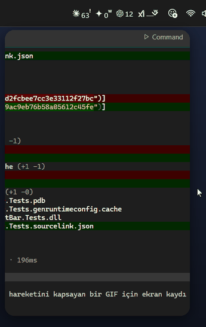

# LimitBar for Windows

**How much of your AI coding limits you've used, on the Windows taskbar.** One glance for Claude Code,
Codex, Gemini (Google Antigravity) and Grok Build; hover for the 5-hour and weekly windows and when they
reset.



A Windows port of [dancik/limitbar](https://github.com/dancik/limitbar) (macOS, MIT) with the same design,
panel and behaviour. Written in C# / WPF (.NET 8), a single ~260 KB exe. No Electron and no browser.

**Product Owner: Umut Çelik** · [X @palamut62](https://x.com/palamut62) · [GitHub palamut62](https://github.com/palamut62)

## What you see

The strip sits on the taskbar, just left of the notification area. It shows one mark and number per installed CLI.

| You see | Meaning |
|---|---|
| `23` | 23 % of the window **used** (5-hour for Claude and Codex) |
| `81ʷ` | a **weekly** window: that service has no 5-hour limit, or the weekly one is what binds |
| **red** | 90 % or more used |
| `23!` | the number shown is fine, but another window of the same service (e.g. the weekly) is at 90 %+ |
| `—` | no reading yet, or the window has reset since the last reading |
| dimmed | the reading is more than 45 minutes old |

Hover to open the panel, or click to pin it. It shows every window, reset times, the plan and anything that
needs attention ("Signed out — run `codex login`"). Click again or anywhere else to close it. Right-click
the strip for About and Quit.

## Install

Requirements: Windows 10/11 and at least one of the CLIs below signed in.

Download from [Releases](https://github.com/palamut62/winlimitbar/releases):

- `LimitBar-win-x64.exe`: needs the [.NET 8 Desktop Runtime](https://dotnet.microsoft.com/download/dotnet/8.0) (small).
- `LimitBar-win-x64-standalone.exe`: no runtime needed (larger).

Check the download against `SHA256SUMS.txt` (`Get-FileHash .\LimitBar-win-x64.exe`). Put it in
`%LOCALAPPDATA%\Programs\LimitBar\` and run it. The exe is not code-signed, so SmartScreen may ask once.

Or build it yourself:

```powershell
dotnet publish src/LimitBar -c Release -r win-x64 --self-contained false -p:PublishSingleFile=true -o dist
mkdir "$env:LOCALAPPDATA\Programs\LimitBar" -Force
copy dist\LimitBar.exe "$env:LOCALAPPDATA\Programs\LimitBar\"
& "$env:LOCALAPPDATA\Programs\LimitBar\LimitBar.exe"
```

Turn on **Launch at Login** in the panel to start it with Windows (per-user `Run` key, no admin needed).

## The CLIs it reads

LimitBar looks only in fixed folders: `%APPDATA%\npm`, `%LOCALAPPDATA%\agy\bin`, `~\.grok\bin`,
`~\.local\bin`, `~\.bun\bin`, `%LOCALAPPDATA%\Volta\bin`. It never searches `PATH`.

| Service | CLI | Sign in | What the strip shows |
|---|---|---|---|
| Claude (Pro / Max) | Claude Code `claude` | run `claude`, then `/login` | 5-hour window |
| Codex (ChatGPT plans) | Codex CLI `codex` | `codex login` | 5-hour window |
| Gemini | Google Antigravity CLI `agy` | run `agy` once | the most-used Gemini quota (often weekly) |
| Grok | Grok Build `grok` | `grok login` | weekly credits |

Installed somewhere else? Put the full path in `%LOCALAPPDATA%\limitbar\settings.json`, for example
`{"codexPath": "D:\\tools\\codex.exe"}`. The same works for `claudePath`, `agyPath` and `grokPath`. Then
restart LimitBar.

### Several accounts of one service

Right-click the strip, **Settings…**, pick Claude or Codex, name the account and press **Add account**. Press
**Terminal** on its row and sign in there. Each account keeps its sign-in in its own folder
(`CLAUDE_CONFIG_DIR` / `CODEX_HOME`), so signing out of one never touches another. Every account gets its own
mark and first letter on the strip and its own section in the panel. A signed-out account stays listed.
Settings also hides services and sets CLI locations. For live Claude numbers per account use
`LimitBar.exe --statusline --profile <name>`.

### Optional: free Claude readings from the status line

By default LimitBar runs `claude -p /usage` at most once every 20 minutes. This makes no model call. For live
numbers at no cost, let Claude Code hand them over on every reply. Add this to `~/.claude/settings.json`
(it **replaces** any status line you already have):

```json
"statusLine": { "type": "command", "command": "C:/Users/<you>/AppData/Local/Programs/LimitBar/LimitBar.exe --statusline" }
```

It prints `Opus · 5h 23% · 7d 41%` and saves only those percentages and reset times to
`%LOCALAPPDATA%\limitbar\claude-status.json`.

## Security and privacy

LimitBar runs these commands, and nothing else:

| Service | Command |
|---|---|
| Claude | `claude auth status --json` (only `loggedIn` and the plan are kept, the email is dropped) |
| Claude | `claude -p /usage --output-format json --max-turns 1 --restricted --strict-mcp-config --no-session-persistence --settings '{"disableAllHooks":true}'` |
| Codex | reads `rate_limits` lines from `~\.codex\sessions\<today>\*.jsonl`; `codex app-server` → `account/rateLimits/read`; `codex login status` |
| Gemini | `agy -p /quota --output-format json` |
| Grok | `grok agent stdio` → `_x.ai/billing` |

- **No credentials, ever.** LimitBar never opens a token, cookie, Credential Manager item or credential file.
- **npm shims are resolved, not run.** For `claude.cmd` and `codex.cmd`, LimitBar starts the real `claude.exe`, or
  `node.exe` plus `codex.js`, directly. `cmd.exe` never parses an argument.
- **Only trustworthy executables.** A CLI, its real target, the interpreter and their folders must be owned
  by you, an administrator, SYSTEM or TrustedInstaller. No other account may write to them, and nobody else
  may replace any parent folder (NTFS ACLs are checked). Anything else shows as "not run".
- **Minimal environment.** Each CLI gets an allowlist: Windows system variables, `HOME`, `LANG`, `NO_COLOR`
  and a fixed `PATH` of checked folders. Your API keys, tokens and `CLAUDECODE` variables are not passed on.
- **Private working directory.** CLIs run in `%LOCALAPPDATA%\limitbar\cwd`, never in a project.
- **Hard limits.** One CLI at a time, a 20–40 s deadline, and the whole process tree (a Job Object) killed afterwards.
- **What it stores.** `%LOCALAPPDATA%\limitbar\state.json` (percentages, reset times, plan names). No
  analytics, no network requests of its own.

**Difference from macOS:** the original runs `codex`, `agy` and `grok` inside a `sandbox-exec` kernel
profile. Windows has no equivalent that would still let those CLIs reach their own state and the network, so
here they run without a filesystem sandbox. The allowlisted environment, the private working directory, the
trust checks and the process-tree kill still apply.

## Build and test

```powershell
dotnet build
dotnet test                                   # parsers (fixtures from the real CLIs), shims, ACL trust, tree kill
src\LimitBar\bin\Debug\net8.0-windows\LimitBar.exe --probe | more   # what every CLI returns right now, as JSON
```

## Uninstall

Quit LimitBar (right-click the strip, or Quit in the panel) and turn off Launch at Login first. Then delete
`%LOCALAPPDATA%\Programs\LimitBar` and `%LOCALAPPDATA%\limitbar`.

## License

MIT, see [LICENSE](LICENSE). Based on dancik/limitbar. Service names and marks belong to their owners;
LimitBar is not affiliated with Anthropic, Google, OpenAI or xAI. The Claude, OpenAI and Gemini marks come
from [simple-icons](https://github.com/simple-icons/simple-icons) 15.10.0 (CC0-1.0). The xAI mark comes from
[@lobehub/icons-static-svg](https://github.com/lobehub/lobe-icons) 1.70.0 (MIT).
